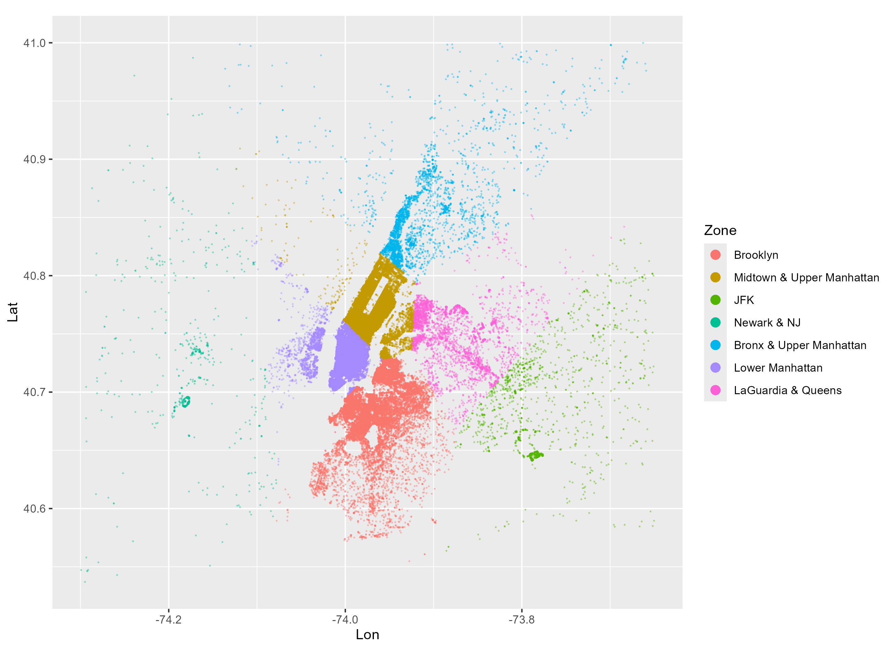
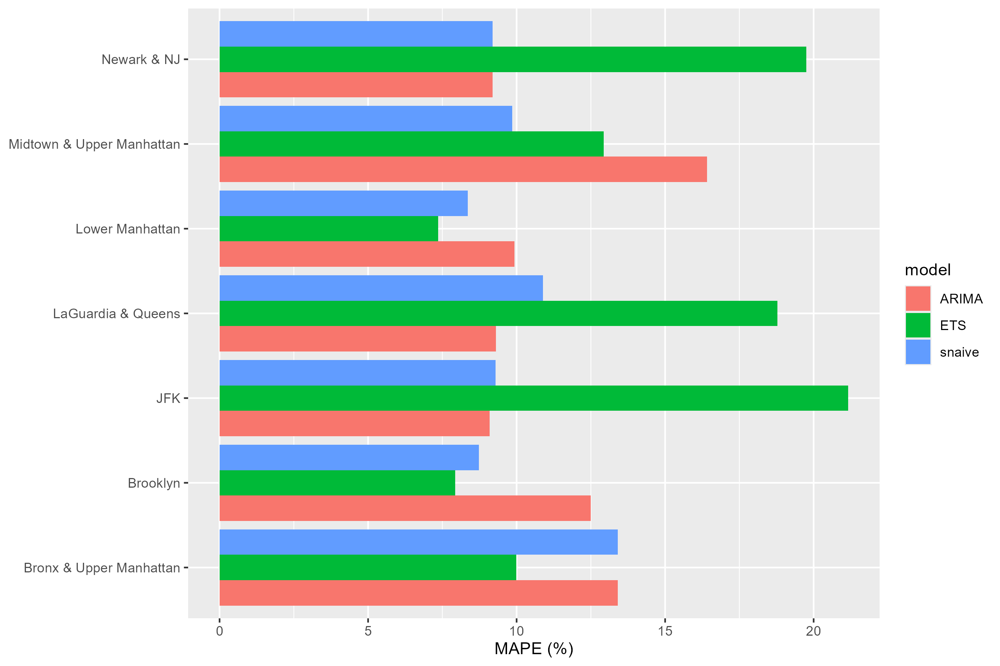

# Where do New Yorkers take Uber?

**Clustering one million Uber pickups in New York City (September 2014) and forecasting demand per area**



## Questions

1. Where are the main pickup areas in New York City?
2. How does demand in each area change during the day?
3. How does it change across the week and the month?
4. Which clustering method and how many clusters work best?
5. Can the clusters help with forecasting?

## Key findings

- **Seven areas.** k-means on the pickup locations finds seven clear areas: two Manhattan areas with three quarters of all pickups, Brooklyn, the Bronx and northern Manhattan, and three airport areas (JFK, LaGuardia and Newark). The clusters explain 83.6% of the variation in pickup locations (average silhouette 0.46).
- **k-means works better than DBSCAN.** DBSCAN puts 89–94% of pickups into one cluster with every setting I tried, because the centre of New York is one big crowded area.
- **Each area is busy at different times.** Midtown is busiest at 17:00 and on Thursdays, Brooklyn and the Bronx late in the evening and on Saturdays, and the airports in the early afternoon and on Sundays. On Labor Day, pickups in Manhattan fell by more than half, while JFK had 56% more than on an average day.
- **Moving centres.** During the day, the centres of the airport areas move by 4–6 km, from nearby neighbourhoods at night to the airports during the day. The Manhattan centres stay within 1 km.
- **Forecasting.** New pickups are put into the right area 99.7% of the time. For daily demand, ETS is best in the regular nightlife areas, and the simple seasonal naive model is best in the areas affected by Labor Day. So the best model depends on the area.



**Read the full report:** [samiribrh.github.io/uber-nyc-clusters/report/uber_report.html](https://samiribrh.github.io/uber-nyc-clusters/report/uber_report.html)

## Data

1,028,136 Uber pickups in New York City between 1 and 30 September 2014: date and time, latitude, longitude and the code of the Uber base.

The data is in `data/raw/uber-data.csv`.

## Methods

k-means · DBSCAN · elbow method · silhouette width · gap statistic · between/total sum of squares · k-centroids clustering with prediction (flexclust) · seasonal naive, ETS and ARIMA forecasting

## Repository structure

```
R/          analysis scripts, run in numerical order
  00_setup.R           installs the packages
  01_load_explore.R    loads and cleans the data
  02_choose_method.R   DBSCAN vs k-means, number of clusters
  03_clusters.R        k-means with seven clusters, quality, map
  04_time_date.R       zones by hour, weekday and date
  05_forecast.R        assigning new pickups and forecasting demand
data/raw/   the raw data (uber-data.csv)
figures/    plots produced by the scripts
report/     R Markdown report and its HTML version
```

## Reproducing the analysis

Open `uber-nyc-clusters.Rproj` in RStudio and run the scripts in `R/` in order, starting with `00_setup.R`. The gap statistic in `02_choose_method.R` takes about half an hour. Then knit `report/uber_report.Rmd`.
